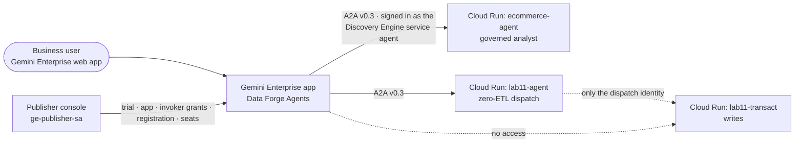

# 🚀 Publish ADK Agents to Gemini Enterprise

Welcome, Enterprise & Cloud Architects! 🏢

Your agents have a problem: they are good at their job, and almost nobody can reach them.

In the **From Data to Agent** lab you built a governed analyst that looks up the official definition of a metric before it writes any SQL. If your event also included the **Zero-ETL Federation** lab, you built a dispatch agent that routes questions across BigQuery, AlloyDB and Spanner and will not write anything until you name the engine. Both run on Cloud Run, and so far only you and a lab console have talked to them.

In this lab you hand them to **business users**. You press one button and both agents show up in **Gemini Enterprise**, where your colleagues already ask questions. They get a chat window. You keep the rules: the same catalog grounding, the same column masking, the same "name an engine before you write" rule, and an IAM boundary that lets Gemini Enterprise call exactly two services and nothing else.

The rule from the earlier labs still holds: **the guardrails live in the platform, not in the prompt.** Publishing must not weaken them, and you will check that it doesn't.

---

## 🎯 Lab Objectives
* **🔌 A2A without rewriting the agent**: See how a small, separate module exposes an existing ADK agent over the Agent2Agent (A2A) protocol, version 0.3, which is the version Gemini Enterprise uses.
* **🖱️ One-click publishing**: Deploy a publisher console that starts the Gemini Enterprise trial, creates the app, grants access and registers your agents.
* **🔐 Least-privilege access**: Understand why Gemini Enterprise gets `run.invoker` on *two services* and not on the whole project.
* **✅ End-to-end proof**: Ask each agent a question *through* Gemini Enterprise and read the grounding footer that shows what actually ran.
* **👥 Business-user hand-off**: Assign licence seats and share one link.

> [!NOTE]
> Registering custom A2A agents in Gemini Enterprise is a **Preview** feature, and this lab uses the **30-day trial edition** of Gemini Enterprise. Before you recommend this architecture to anyone, check the current release status, SLA and terms in the official product documentation.

### 🗺️ What You Are Building



Read the dotted line twice: Gemini Enterprise can reach the agents, but it **cannot** reach the service that writes data. That boundary is the main thing this lab protects.

---

## 👤 Target Persona
* **Primary: Enterprise & Cloud Architects**: turning agents into something an organisation can use, with identity boundaries, least-privilege IAM, licensing and hand-off.
* **Secondary: App Modernization & Software Developers**: exposing an existing ADK agent over A2A on Cloud Run without touching its business logic.

---

## 🧭 Before You Start

| You need | Why |
|---|---|
| The **From Data to Agent** lab, completed up to and including deploying the agent | This lab publishes its `ecommerce-agent` service. |
| The **Zero-ETL Federation** lab, completed up to and including deploying the agent *(optional)* | Its `lab11-agent` gets published as well. Without it, you publish one agent and everything else works the same. |
| Your Cloud Workstation terminal | Every terminal command below runs there. |

### 🔗 Your Consoles, One Click Away

These links open the Cloud Run page of each web app **in the project you currently have selected** in the Cloud console. The page shows the app's URL at the top. Click it to open the app.

| Web app | Cloud console link |
|---|---|
| Publisher console (this lab, after Step 3) | [ge-publisher](https://console.cloud.google.com/run/detail/us-central1/ge-publisher) |
| From Data to Agent console | [lab-runner](https://console.cloud.google.com/run/detail/us-central1/lab-runner) |
| Zero-ETL Federation console | [lab11-runner](https://console.cloud.google.com/run/detail/us-central1/lab11-runner) |

You prefer the terminal? This prints every web app URL in your project:

```bash
gcloud run services list --format="table(SERVICE:metadata.name, URL:status.url)"
```

Once the publisher is deployed, every lab console also has a tab that links to the others, so you rarely need these links.

---

## ⚡ Step 1: Verify the Pre-provisioned Infrastructure
**🖥️ TERMINAL**

Terraform has already done four things for you:
* enabled the Gemini Enterprise (Discovery Engine) APIs,
* created the publisher's identity, `ge-publisher-sa`,
* created the **Discovery Engine service agent**, the identity Gemini Enterprise uses when it calls your agents,
* created the `lab12` Artifact Registry repository.

Check that it is all there:

```bash
cd ~/labs/*gemini_enterprise_agents/assets
./verify.sh
```

Every line should read `[PASS]` or `[INFO]`. The `[INFO]` lines about Cloud Run services list which agents are deployed so far.

---

## 🔌 Step 2: Look at How the Agents Speak A2A
**🖥️ TERMINAL**

You don't build anything in this step. You read one file to understand how the agents talk to Gemini Enterprise. Both agents import this module:

```bash
less ~/labs/*bigquery_agentic_data_cloud/assets/agent/a2a_surface.py
```

Look for three things:

1. **It wraps the same agent object as `/chat`.** Gemini Enterprise and the lab console run identical logic. The files you edited earlier (`agent.py`, `router.py`, `orchestrator.py`) are untouched. A2A is a second door into the same room.
2. **It serves two routes.**
   * `GET /a2a/.well-known/agent-card.json` returns the **agent card**, the agent's business card: name, description, skills and the URL to call. Gemini Enterprise reads it to decide what the agent is good at.
   * `POST /a2a/` takes the actual questions as A2A JSON-RPC calls.
3. **It adds a grounding footer.** Gemini Enterprise shows only the final answer, not the tool trace you saw in the lab console. In these labs an answer without evidence doesn't count, so every answer ends with a **Grounding** block. It names the agents and tools that ran and the SQL they sent.

Notice what the module does **not** contain: authentication code. The service stays private, and Cloud Run IAM decides who may call `/a2a/`. You make that decision in Step 4.

---

## 🛠️ Step 3: Deploy the Publisher Console
**🖥️ TERMINAL**

```bash
bash deploy.sh
```

The script builds one container image and deploys the `ge-publisher` service, which runs as `ge-publisher-sa`. Then it prints the URL. It also lists the agent services it can see. If you skipped the Zero-ETL Federation lab, a warning about `lab11-agent` is expected.

Open the printed URL, or use the [ge-publisher link](https://console.cloud.google.com/run/detail/us-central1/ge-publisher) from the table above.

---

## 🖱️ Step 4: Publish ADK Agents to Gemini Enterprise
**🌐 CONSOLE**

In the publisher console:

1. **Your agents** shows `deployed` next to each agent service it found.
2. *(Optional)* Under **Business users**, enter the email addresses of colleagues who should get a seat. They must belong to your project's organisation domain. You always get a seat yourself.
3. Press **Publish ADK Agents to Gemini Enterprise**.

The checklist fills in as each step finishes, usually within a minute. Here is what each line means:

| Step | What happened behind the button |
|---|---|
| Gemini Enterprise enabled | Accepted the Gemini Enterprise terms for this project. |
| Sign-in with Google identity | Users sign in with their organisation accounts. |
| Trial licence | Started the 30-day **trial edition**, or reused an active licence. |
| Gemini Enterprise app | Created the **Data Forge Agents** app. It has no data stores. Its only job is to host your agents. |
| One line per agent | Granted `roles/run.invoker` **on that one service** to the Discovery Engine service agent, read the agent card, registered the agent and **shared it with all users of the app**. |
| Licence seats | Assigned seats to you and to the business users you named. |
| Web app link | The URL business users open. |

You can press the button as often as you like. Every step checks what already exists and adds only what is missing.

> [!IMPORTANT]
> **Why grant access per service, not per project?** The Gemini Enterprise documentation shows a project-wide `run.invoker` grant. That is convenient, but here it would let Gemini Enterprise call `lab11-transact`, the only service allowed to write data, and the Zero-ETL Federation lab's safety design would be gone. So the publisher grants invoker on `ecommerce-agent` and `lab11-agent` only. Check it yourself:
> ```bash
> REGION=us-central1
> for s in ecommerce-agent lab11-agent lab11-transact; do
>   echo "== $s"; gcloud run services get-iam-policy "$s" --region="$REGION" \
>     --format="table(bindings.role, bindings.members)" 2>/dev/null | grep -i discoveryengine || echo "   (no Gemini Enterprise access)"
> done
> ```
> You should see the Discovery Engine service agent on the first two services and **not** on `lab11-transact`.

---

## ✅ Step 5: Ask Through Gemini Enterprise
**🌐 CONSOLE**

Still in the publisher console, go to **Try an agent** and press a question button. The console sends the question **through Gemini Enterprise's own A2A proxy**, and the proxy calls your Cloud Run agent as the Discovery Engine service agent. A business user's question takes exactly the same path. So one good answer proves three things at once: the registration, the invoker grant and the A2A module all work. Look for `route: gemini-enterprise` on the answer.

Try these and read the **Grounding** footer under each answer:

| Agent | Question | What to look for |
|---|---|---|
| Governed analyst | *What is our revenue?* | `search_entries` runs before any SQL, and the SQL filters on `status = 'Complete'`, the governed definition of revenue. |
| Governed analyst | *Who are our top 5 high-value customers?* | Customer emails come back masked (`XXXXX@…`). The agent always runs as the Masked Reader, no matter who asks. |
| Zero-ETL dispatch | *What is our revenue by product category?* | The question goes to the analytics specialist, and the footer shows federated SQL. |
| Zero-ETL dispatch | *Insert a new order for customer 42.* | No engine was named, so the dispatch agent asks **which engine**, and nothing is written. |

The last row is the one to remember: even through a new front door, an unclear write request is still refused.

---

## 👥 Step 6: How It Works in the Real World
**🌐 CONSOLE**

In production, an administrator wires agents to Gemini Enterprise apps in the admin console, and business users only ever see the web app. See what the publisher set up for you:

1. In the Cloud console, open **Gemini Enterprise → Apps → Data Forge Agents**.
2. Look at the app's agents: both A2A agents are registered on this one app.
3. Look at the app's users and licences: the seats from Step 4 decide who can use these agents.

---

## 🧹 Clean Up & Recap

There is nothing to clean up: everything in this lab is removed when the event ends, and the trial licence expires on its own after 30 days.

**What you proved:**
* An existing ADK agent can reach business users without any change to its business logic.
* Publishing did not weaken governance: grounding, masking and the write boundary all held, and the footer showed the evidence.
* Least privilege is a choice you make. The convenient project-wide grant would have opened the write path. The per-service grant did not.

---

## 📚 Appendix: What the Publisher Calls

Every step behind the button is a plain REST call. Nothing in this lab requires a special SDK.

| Step | API (all on `discoveryengine.googleapis.com` unless noted) |
|---|---|
| Enable | `POST v1alpha/projects/{number}:provision` |
| Identity | `PATCH v1alpha/projects/{id}/locations/global/aclConfig` |
| Trial licence | `POST v1alpha/projects/{number}/locations/global/licenseConfigs` (`freeTrial: true`) |
| App | `POST v1alpha/projects/{id}/locations/global/collections/default_collection/engines` |
| Invoker grant | `run.googleapis.com` `v2 …/services/{svc}:setIamPolicy` (per service) |
| Register | `POST v1alpha/{engine}/assistants/default_assistant/agents` with `a2aAgentDefinition.jsonAgentCard` |
| Seats | `POST v1alpha/projects/{number}/locations/global/userStores/default_user_store:batchUpdateUserLicenses` |
| Link | `GET v1alpha/{engine}/widgetConfigs/default_search_widget_config` → `configId` |
| Try it | `POST v1/{agent}/a2a/v1/message:send` (the Gemini Enterprise A2A proxy) |

Source: [`publisher/ge.py`](src/publisher/ge.py).
